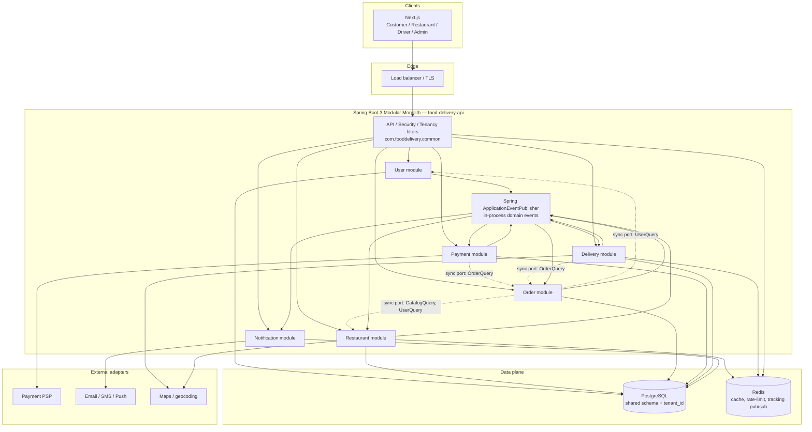

# System Architecture — Food Delivery SaaS (Layer 2)

**Status:** Draft for Layer 2 (System Architecture)  
**Depends on:** [system-design.md](./system-design.md)  
**Style:** Modular monolith — one Spring Boot 3 process, one PostgreSQL, optional Redis  
**Frontend:** Next.js (App Router), role-based route groups against one API

> Layer 2 locks **module boundaries, folder structure, communication, and risks**. It does not contain application code, Maven/Gradle files, or entity implementations.

---

## 1. Architectural intent

Ship V1 as a **modular monolith**:

- **One artifact** (`food-delivery-api`) so we can hit 99.9% uptime and &lt;2s p95 without distributed-system tax.
- **Six business modules** named after the domain: User, Restaurant, Order, Payment, Delivery, Notification.
- **Package-by-feature**, not package-by-layer at the top level.
- **Dependencies point inward to `common` and sideways only through published APIs / events** — never into another module’s `infrastructure` or JPA entities.

Extract a module to a service only after a measured bottleneck (typically Delivery location fan-out or Payment webhooks).

---

## 2. Component diagram (modular monolith)



**How to read the arrows**

- Solid `API → module`: HTTP adapters in that module handle the request.
- Dashed `sync port`: **read-only interface** owned by the *providing* module, implemented in that module, consumed by another. No JPA entity sharing.
- `module → BUS`: publish domain events. Subscribers must be **idempotent**.

---

## 3. Module responsibilities and ownership

| Module | Owns (write) | Must not |
| --- | --- | --- |
| **User** | Customer, staff, driver, admin identities; credentials; roles; addresses (customer); driver profile | Menu, orders, charges |
| **Restaurant** | Tenant, storefront, hours, menu, availability, pause | Payment capture, driver assignment |
| **Order** | Cart, order aggregate, line snapshots, order state machine | PSP API calls; driver GPS |
| **Payment** | Payment intents, webhook inbox, refund records | Order line edits |
| **Delivery** | Assignment, delivery state, location pings, tracking sessions | Menu; charging customers |
| **Notification** | Templates, outbox of messages, provider send | Business decisions (no “cancel order” from here) |
| **common** | Auth filters, tenant context, error model, event base types, clock, IDs | Business workflows |

**Ownership rule:** if two modules need the same write, the row’s classification in Layer 1 decides. Orders are written only by Order (Delivery/Payment emit events; Order listens and mutates *order* state).

---

## 4. Exact Java package-by-feature structure

Root package: `com.fooddelivery`.

Each feature module repeats the same **internal** layers (`api` → `application` → `domain` ← `infrastructure`). Other modules may depend only on `*.api` query/command ports and `*.domain.event` types that are explicitly exported (prefer events in `common.event` or a thin `*.api.event` package — see §5).

```text
backend/src/main/java/com/fooddelivery/
├── FoodDeliveryApplication.java
│
├── config/                              # wiring only (security, jackson, async, redis)
│   ├── SecurityConfig.java
│   ├── AsyncConfig.java
│   ├── RedisConfig.java
│   └── PersistenceConfig.java
│
├── common/
│   ├── api/                             # ProblemDetail, pagination, idempotency filter
│   ├── security/                        # Jwt, CurrentUser, method security
│   ├── tenancy/                         # TenantContext, TenantFilter, TenantEntity
│   ├── event/                           # DomainEvent base, EventMetadata
│   ├── exception/                       # DomainException → HTTP mapping
│   └── persistence/                     # BaseAuditedEntity, clock, UUID strategy
│
├── user/
│   ├── api/
│   │   ├── UserController.java          # customer profile, addresses
│   │   ├── AuthController.java
│   │   ├── dto/
│   │   └── query/                       # UserQueryPort (for other modules)
│   ├── application/
│   │   ├── AuthService.java
│   │   └── UserService.java
│   ├── domain/
│   │   ├── User.java
│   │   ├── Address.java
│   │   ├── Role.java
│   │   └── event/
│   └── infrastructure/
│       ├── UserRepository.java
│       └── jwt/
│
├── restaurant/
│   ├── api/
│   │   ├── RestaurantController.java    # public discovery + tenant admin
│   │   ├── MenuController.java
│   │   ├── dto/
│   │   └── query/                       # CatalogQueryPort (geo + menu snapshot)
│   ├── application/
│   │   ├── DiscoveryService.java
│   │   ├── MenuService.java
│   │   └── StorefrontService.java
│   ├── domain/
│   │   ├── Restaurant.java              # tenant aggregate
│   │   ├── MenuItem.java
│   │   ├── MenuCategory.java
│   │   ├── OpeningHours.java
│   │   └── event/
│   └── infrastructure/
│       ├── RestaurantRepository.java
│       ├── MenuRepository.java
│       └── cache/                       # Redis menu/discovery
│
├── order/
│   ├── api/
│   │   ├── CartController.java
│   │   ├── OrderController.java
│   │   ├── dto/
│   │   └── query/                       # OrderQueryPort
│   ├── application/
│   │   ├── CartService.java
│   │   ├── PlaceOrderService.java
│   │   └── OrderStateService.java       # listens to payment/delivery events
│   ├── domain/
│   │   ├── Cart.java
│   │   ├── Order.java
│   │   ├── OrderLine.java
│   │   ├── OrderStatus.java
│   │   └── event/
│   │       ├── OrderPlacedEvent.java
│   │       ├── OrderAcceptedEvent.java
│   │       ├── OrderRejectedEvent.java
│   │       ├── OrderCancelledEvent.java
│   │       └── OrderReadyEvent.java
│   └── infrastructure/
│       ├── OrderRepository.java
│       └── CartRepository.java
│
├── payment/
│   ├── api/
│   │   ├── PaymentController.java       # start intent (authenticated)
│   │   ├── PaymentWebhookController.java
│   │   └── dto/
│   ├── application/
│   │   ├── PaymentService.java
│   │   └── WebhookInboxService.java
│   ├── domain/
│   │   ├── Payment.java
│   │   ├── PaymentStatus.java
│   │   └── event/
│   │       ├── PaymentAuthorizedEvent.java
│   │       ├── PaymentFailedEvent.java
│   │       ├── PaymentCapturedEvent.java
│   │       └── PaymentRefundedEvent.java
│   └── infrastructure/
│       ├── PaymentRepository.java
│       ├── WebhookInboxRepository.java
│       └── psp/                         # PSP adapter
│
├── delivery/
│   ├── api/
│   │   ├── DriverController.java
│   │   ├── DispatchAdminController.java
│   │   ├── TrackingController.java
│   │   └── dto/
│   ├── application/
│   │   ├── DispatchService.java
│   │   ├── TrackingService.java
│   │   └── DriverPresenceService.java
│   ├── domain/
│   │   ├── DeliveryJob.java
│   │   ├── DriverPresence.java
│   │   └── event/
│   │       ├── DriverAssignedEvent.java
│   │       ├── OrderPickedUpEvent.java
│   │       └── OrderDeliveredEvent.java
│   └── infrastructure/
│       ├── DeliveryRepository.java
│       ├── location/                    # Redis geo / pub-sub
│       └── maps/
│
└── notification/
    ├── api/                             # admin template hooks only; no public “send”
    ├── application/
    │   └── NotificationListeners.java   # @EventListener / @TransactionalEventListener
    ├── domain/
    │   ├── NotificationOutbox.java
    │   └── event/                       # none required outbound for V1
    └── infrastructure/
        ├── OutboxRepository.java
        └── gateway/                     # email/SMS/push adapters

backend/src/main/resources/
├── application.yaml
├── db/migration/                        # Flyway, later layer
└── messages.properties

backend/src/test/java/com/fooddelivery/
├── architecture/                        # ArchUnit: package dependency rules
├── tenancy/                             # cross-tenant isolation tests
└── <module>/                            # module tests mirror production packages
```

Frontend (not Java, shown for boundary clarity only):

```text
frontend/
└── src/app/
    ├── (customer)/
    ├── (restaurant)/
    ├── (driver)/
    └── (admin)/
```

**Package dependency rules (enforced later with ArchUnit)**

1. `*.infrastructure` must not be imported outside its module.
2. `*.domain` of module A must not import `*.domain` of module B.
3. Cross-module **sync** calls go through `*.api.query` ports only.
4. Only `common` is imported freely (and it must not import feature modules).
5. `notification` must not import other modules’ `application` or `infrastructure`; it consumes events.

---

## 5. Inter-module communication strategy

### 5.1 Default: in-process domain events

Use **Spring `ApplicationEventPublisher`** + **`@TransactionalEventListener(phase = AFTER_COMMIT)`** for side effects that must not run if the originating transaction rolls back.

**Canonical events (V1)**

| Event | Publisher | Subscribers |
| --- | --- | --- |
| `OrderPlacedEvent` | Order | Payment (ensure intent linked), Notification, Restaurant (ticket), Delivery (optional pre-position) |
| `PaymentAuthorizedEvent` | Payment | Order (confirm `PLACED`/`PAID`), Notification |
| `PaymentFailedEvent` | Payment | Order (fail/cancel), Notification |
| `OrderAcceptedEvent` | Order | Notification, Delivery (if assign-early) |
| `OrderRejectedEvent` / `OrderCancelledEvent` | Order | Payment (void/refund), Notification, Delivery (release) |
| `OrderReadyEvent` | Order | Delivery (dispatch), Notification |
| `DriverAssignedEvent` | Delivery | Order (status), Notification |
| `OrderPickedUpEvent` | Delivery | Order, Notification |
| `OrderDeliveredEvent` | Delivery | Order (complete), Payment (capture if auth-then-capture), Notification |
| `PaymentCapturedEvent` / `PaymentRefundedEvent` | Payment | Order, Notification |

**Event payload rules**

- Include: `eventId`, `occurredAt`, `tenantId`, aggregate ids (`orderId`, …), **not** large graphs.
- Subscribers load what they need via their own repositories or query ports.
- Listeners are **idempotent** on `eventId` / aggregate version.
- Never wrap listener work in the publisher’s transaction (AFTER_COMMIT).

### 5.2 Sync query ports (allowed, narrow)

Use method calls on ports when the caller is in the **same request** and needs a consistent snapshot:

- `PlaceOrderService` → `CatalogQueryPort.getSellableMenuSnapshot(tenantId, itemIds)`  
- `PlaceOrderService` → `UserQueryPort.getActiveAddress(customerId)`  
- `DispatchService` → `OrderQueryPort.getReadyOrder(orderId, tenantId)`

These ports return **immutable DTOs**, never JPA entities.

**Forbidden:** Order service injecting `MenuRepository`; circular module dependencies; HTTP-between-modules; Kafka/Rabbit as the V1 backbone.

### 5.3 Reliability upgrade path (same interfaces)

When AFTER_COMMIT listeners are not enough (process crash after commit, before notify):

1. **Transactional outbox table** in the publisher’s schema (`common` helper).
2. In-process poller publishes the same event types.
3. Only then consider a broker — **without changing event names or payloads**.

Payment **webhooks** already use an **inbox table** (at-least-once, deduped by PSP event id).

### 5.4 Frontend communication

- Next.js → REST/JSON on `/api/v1/...` (exact OpenAPI is a later layer).
- Tracking: SSE or short-lived websocket **to the monolith**; Delivery module publishes location to Redis pub/sub; API fan-out stays inside Delivery.
- No Next.js talking to PostgreSQL.

---

## 6. Runtime topology (V1)

```text
Browser (Next.js)
    → TLS load balancer
        → n × stateless Spring Boot instances
            → PostgreSQL primary (writes)
            → PostgreSQL replica (discovery/menu reads, when enabled)
            → Redis (cache, rate limit, driver geo, tracking fan-out)
        → PSP / SMS / Maps (egress)
```

Health: `/health/live` (process), `/health/ready` (DB + Redis). Ready fail → instance out of LB, supporting 99.9% with rolling deploys.

---

## 7. The three riskiest decisions — and mitigations

### Risk 1 — Modular monolith decays into a “big ball of mud”

**Why it is risky:** six modules in one JVM make illegal imports *easy*. Once Order reaches into Restaurant JPA mappings, tenancy filters and future extraction both die. Vibe-coded features tend to dump logic in `common` or a `util` service.

**Mitigation**

- Folder law in §4 is mandatory; `common` is not a business module.
- ArchUnit tests fail the build on forbidden dependencies (Layer 3+).
- Code review checklist: “which module owns this write?”
- Query ports + events only; no shared Hibernate entities across modules.
- If a change needs files in 3+ modules, stop and redesign the event/port.

### Risk 2 — Order / Payment consistency without 2PC

**Why it is risky:** checkout spans Order persist + PSP. Dual writes cause “paid but no order” or “order with no money”. This is the highest-money failure mode and directly hits trust and 99.9% *correct* availability.

**Mitigation**

- **Idempotency-Key** on place-order and on create-payment-intent.
- State machine: order `PENDING_PAYMENT` until `PaymentAuthorizedEvent`.
- PSP **webhook inbox** (dedupe, persist raw payload, then emit events).
- `AFTER_COMMIT` listeners + **outbox** before we rely on in-memory events for money side effects.
- Refunds are Payment-owned; Order only reflects `REFUNDED`.
- Reconciliation job: `PENDING_PAYMENT` older than T minutes vs PSP.

### Risk 3 — Real-time tracking and peak-dinner reads inside one process

**Why it is risky:** handwritten NFRs imply dinner peaks and live tracking. Driver pings and catalog stampedes can exhaust the request pool and blow the **p95 &lt; 2s** budget even if business logic is fine.

**Mitigation**

- Location ingest is **write-light**: Redis GEO + pub/sub; PostgreSQL stores waypoints sparsely, not every ping.
- Separate Tomcat/WebFlux thread budget later if needed; V1: timeout + reject location pings with 429 rather than block checkout.
- Cache restaurant discovery and menus in Redis (TTL ≤ 60s; tenant pause publishes eviction event).
- Horizontal scale **stateless** instances first; pin sticky sessions never.
- Circuit-break Maps/PSP/SMS; checkout must not call Maps synchronously more than once (precompute zone).
- Explicit **extract trigger:** if Delivery CPU or Redis pub/sub saturates instances while Order p95 is still healthy, extract Delivery+tracking first — event names stay the same.

---

## 8. Mapping NFRs to architecture

| NFR | Architectural response |
| --- | --- |
| p95 &lt; 2s | Cache catalog; thin checkout path; no sync notification I/O; DB indexes on `tenant_id` + geo |
| 99.9% uptime | Stateless multiply; ready checks; degraded notify/dispatch; rolling deploys |
| High traffic | Redis + replica reads; idempotent writes; scale instances before splitting services |
| Tenant isolation | `TenantContext` + Hibernate filter + Arch/tenancy tests |

---

## 9. Explicitly deferred (do not sneak into V1 architecture)

- Kafka / Rabbit / saga orchestrators as default.
- Per-module databases.
- CQRS with a separate read model service (a DB replica + Redis is enough).
- Kubernetes operators, service mesh.
- Elasticsearch (revisit if discovery quality fails, not for scale theatre).

---

## 10. Handoff to Layer 3+

Next layers may add: API contracts, physical ERD, threat model, CI, and then code in the packages above. Until then:

- Do not create Spring starters, `pom.xml` / `build.gradle`, or Java types.
- Do not add a seventh module without updating both Layer 1 and this file.
