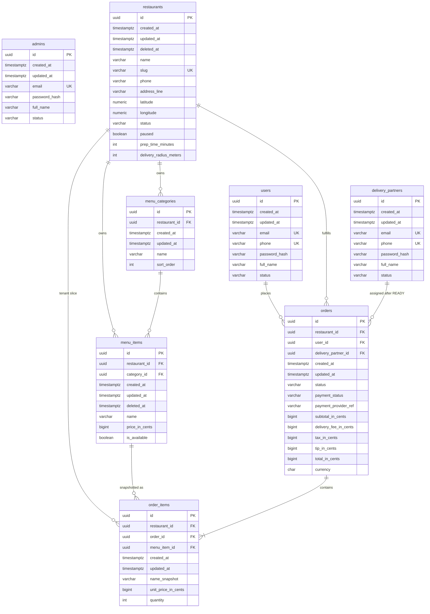

# Layer 3 — Databases & Storage

**Status:** V1 initial schema  
**Source of truth:** `backend/src/main/resources/db/migration/V1__initial_schema.sql`  
**Tenancy:** [ADR 0001](./decisions/0001-marketplace-tenancy-model.md)

Hibernate `ddl-auto` is **`validate`**. All schema change = new Flyway version.

---

## Entity-relationship diagram

`admins` has no FKs in V1 (platform operator identity only).

**Tenant key:** `restaurants.id`. Child tenant tables carry `restaurant_id`.  
`order_items.restaurant_id` is denormalized so kitchen/admin queries never scan another tenant’s lines.

---

## Indexes (and why)

| Index | Why |
| --- | --- |
| PK / UNIQUE on `id`, emails, phones, restaurant `slug`, `orders.payment_provider_ref` | Lookups and idempotent PSP refs |
| All FK columns (`restaurant_id`, `user_id`, `category_id`, `order_id`, `menu_item_id`, `delivery_partner_id`) | PostgreSQL does **not** index FKs automatically; joins, `ON DELETE`, and tenant filters would sequential-scan |
| `(restaurant_id, status, created_at DESC)` on `orders` | Restaurant live ticket board (filter tenant + status, sort newest) |
| `(user_id, created_at DESC)` on `orders` | Customer order history |
| `(restaurant_id)` on `menu_categories` / `menu_items` (items also `WHERE deleted_at IS NULL`) | Public menu + tenant CMS; skip tombstoned items |
| `(restaurants.status) WHERE deleted_at IS NULL` | Discovery of live restaurants |
| `(orders.status, created_at)` | Admin / dispatch queues (platform) |

Partial unique on `payment_provider_ref` allows many unpaid rows with `NULL` ref.

---

## What this migration deliberately omits

Payment intents table, webhook inbox, carts, addresses book, restaurant staff, deliveries/GPS, notification outbox, opening-hours rows. Columns on `orders` cover pay-then-confirm and post-READY driver FK until those modules get their own tables (later layers / later Flyway versions).
